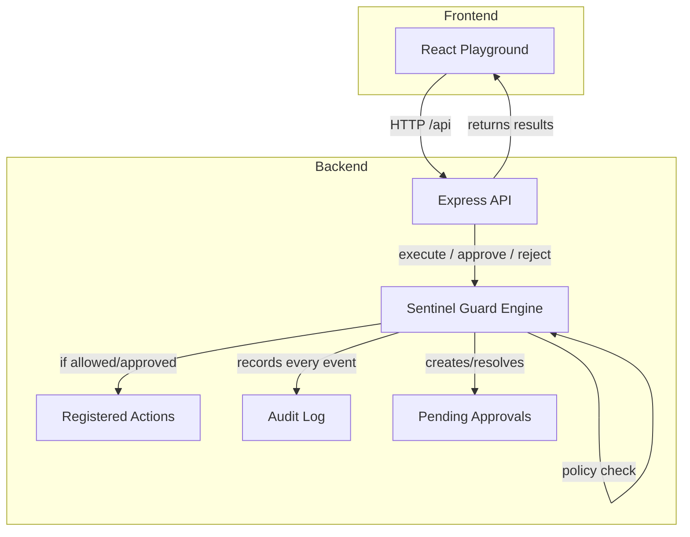

# Sentinel Guard

A reusable, declarative permission-enforcement library for TypeScript applications, with an Express backend and an interactive React playground.

## Problem Statement

Applications need a centralized way to decide whether an action should be allowed, denied, or require human approval before executing. Hardcoding these checks scattered across handlers is error-prone and difficult to audit. Sentinel Guard provides a single enforcement boundary where every action passes through a declarative policy engine before its handler runs.

## Objectives

- Deliver a genuine, reusable TypeScript library that performs real permission enforcement — not a simulation.
- Provide a backend that imports and uses the actual library.
- Provide a professional developer-tool interface for interactively demonstrating enforcement behavior.
- Include automated tests that verify enforcement correctness.

## Features

- **Declarative policy engine**: map actions to `allow`, `deny`, or `approval-required` decisions.
- **Default deny**: unknown or unconfigured actions are automatically denied.
- **Action registration**: only registered async handlers can execute — no arbitrary code from requests.
- **Approval workflow**: approval-required actions create pending requests that must be explicitly approved or rejected. Approved actions execute exactly once; rejected actions never execute.
- **Audit logging**: every permission check and execution attempt is recorded with metadata. Sensitive inputs are never stored.
- **Structured result types**: callers can distinguish allowed, denied, approval-required, approved, rejected, and error states.
- **Input validation**: policy configurations and request bodies are validated at the boundary.

## Technology Stack

| Layer | Technology |
|-------|-----------|
| Core library | TypeScript (framework-independent) |
| Backend | Node.js, Express, Zod |
| Frontend | React, TypeScript, Vite, Tailwind CSS |
| Icons | Lucide React |
| Testing | Vitest |

## Architecture



The frontend communicates exclusively through the backend API. The backend imports and executes the real `@sentinel-guard/core` library. The policy engine evaluates every action before its handler can run.

## Repository Structure

```
sentinel-guard/
├── packages/
│   └── sentinel-guard/        # Core permission-enforcement library
│       ├── src/
│       │   ├── index.ts        # Public API entry point
│       │   ├── types.ts        # Type definitions
│       │   ├── errors.ts       # Error classes
│       │   └── guard.ts        # Guard engine implementation
│       ├── tests/
│       │   └── guard.test.ts   # 17 enforcement behavior tests
│       └── package.json
├── apps/
│   └── api/
│       └── server.ts           # Express API with demo actions
├── src/                        # React playground frontend
│   ├── components/             # UI components (Button, Badge, Toast, etc.)
│   ├── lib/                    # API client and router
│   └── pages/                  # Overview, Tester, Policy, Approvals, Audit, Docs
├── vite-api-plugin.ts          # Vite plugin that mounts the Express API
├── vite.config.ts
└── package.json
```

## Installation

```bash
npm install
```

No API keys, external services, or database configuration required. All data is in-memory.

## Commands

| Command | Description |
|---------|-------------|
| `npm run dev` | Start the development server (frontend + API on one port) |
| `npm run build` | Build the production bundle |
| `npm test` | Run the core library test suite |
| `npm run typecheck` | Type-check the project |
| `npm run preview` | Preview the production build |

## Public Library API

The core library is at `packages/sentinel-guard/src/index.ts` and exports:

| Export | Description |
|--------|-------------|
| `createGuard(options)` | Create a guard instance with policy rules |
| `guard.registerAction(name, handler)` | Register an async action handler |
| `guard.execute(action, input?)` | Execute an action through the policy engine |
| `guard.getPendingApprovals()` | List pending approval requests |
| `guard.approve(id)` | Approve and execute a pending request |
| `guard.reject(id)` | Permanently reject a pending request |
| `guard.getAuditLog()` | Retrieve all audit events |
| `guard.getPolicy()` | Get the current policy configuration |
| `guard.getRegisteredActions()` | List registered action names |

### Error Classes

`GuardError` (base), `UnknownActionError`, `DeniedActionError`, `ApprovalNotFoundError`, `InvalidApprovalStateError`, `InvalidPolicyError`, `HandlerError`

## Code Examples

```ts
import { createGuard } from "@sentinel-guard/core";

const guard = createGuard({
  rules: {
    "file:read": "allow",
    "file:delete": "approval-required",
    "secret:access": "deny"
  }
});

guard.registerAction("file:read", async (input) => {
  return { content: "file contents" };
});

// Allowed — handler executes
const result = await guard.execute("file:read", { filename: "sample.txt" });
// result.status === "allowed"

// Approval required — handler does not execute yet
const pending = await guard.execute("file:delete", { filename: "sample.txt" });
// pending.status === "approval-required", pending.approvalId is set

// Approve — handler executes exactly once
const approved = await guard.approve(pending.approvalId);
// approved.status === "approved"

// Reject — handler never executes
guard.reject(pending.approvalId);
```

## API Endpoints

| Method | Endpoint | Description |
|--------|----------|-------------|
| GET | `/api/health` | Health check |
| GET | `/api/policy` | Current policy rules |
| GET | `/api/actions` | Registered demo actions |
| POST | `/api/execute` | Execute an action (body: `{ action, input? }`) |
| GET | `/api/approvals` | List pending approvals |
| POST | `/api/approvals/:id/approve` | Approve a pending request |
| POST | `/api/approvals/:id/reject` | Reject a pending request |
| GET | `/api/audit` | Retrieve audit events |

## Demo Instructions

1. Run `npm run dev` to start the application.
2. Open the **Permission Tester** page.
3. **File Read** — select "File Read" and click "Run Action". The action is allowed and returns file contents.
4. **File Delete** — select "File Delete" and click "Run Action". A pending approval request is created. The handler does not execute.
5. Go to the **Approval Center** to approve or reject the pending request.
   - **Approve**: the simulated deletion executes once. Check the **Audit Logs** page to verify.
   - **Reject**: the handler never executes. Verify in the audit log.
6. **Secret Access** — select "Secret Access" and click "Run Action". The action is denied. The handler is never invoked.
7. Visit the **Audit Logs** page to see all recorded decisions and outcomes.

## Security Model

**Permission decision vs. enforcement**: A policy *decision* determines whether an action is allowed, denied, or requires approval. *Enforcement* is the act of actually executing or blocking the action based on that decision. Sentinel Guard performs both — it evaluates the policy and then enforces the outcome. The handler only runs if the policy permits it.

Key properties:
- **Default deny**: unconfigured actions are denied.
- **No arbitrary code execution**: only registered handlers can run. The browser and HTTP requests cannot supply executable code.
- **Single execution guarantee**: approved actions execute exactly once. Duplicate approval attempts are rejected.
- **Audit trail**: every permission check is recorded without exposing sensitive inputs.
- **Server-side enforcement**: the backend enforces rules independently of the frontend. Hiding or disabling a button is never the only protection.

## Limitations

- **In-memory state**: pending requests, audit logs, and simulated resources reset when the server restarts.
- **Single-process concurrency**: suitable for demonstration, not distributed deployments.
- **No persistence layer**: all data is ephemeral by design.
- **Not a complete security solution**: this is a permission-enforcement library. Protected operations must pass through the enforcement boundary to be protected.
- **Not published to npm**: the package is locally installed as a workspace dependency in this prototype.

## Future Enhancements

- Persistent storage for audit logs and pending approvals.
- Role-based and attribute-based policy rules.
- Time-bound and conditional approval workflows.
- Multi-tenant support.
- WebSocket notifications for approval state changes.

## npm Publication

The package is configured with publish-ready metadata. To publish:

```bash
cd packages/sentinel-guard
npm publish --access public
```

The package has **not** been published in this prototype.
